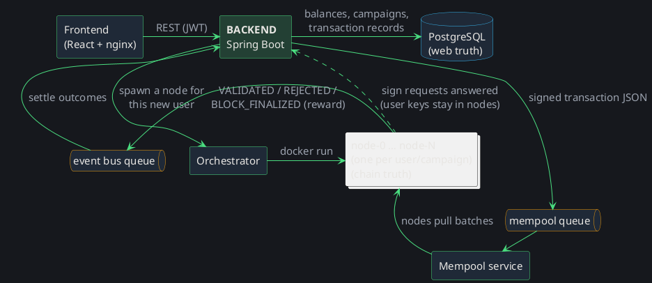
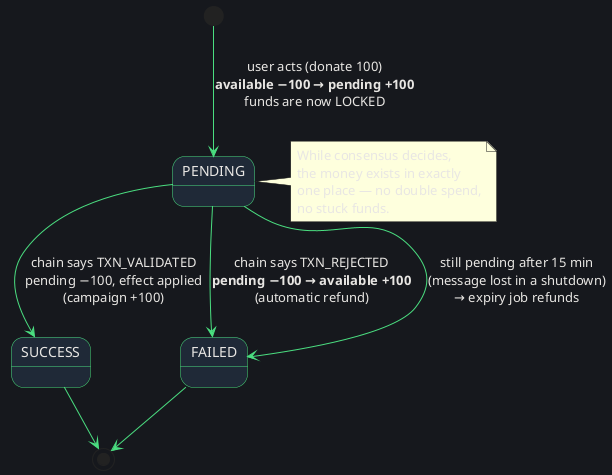
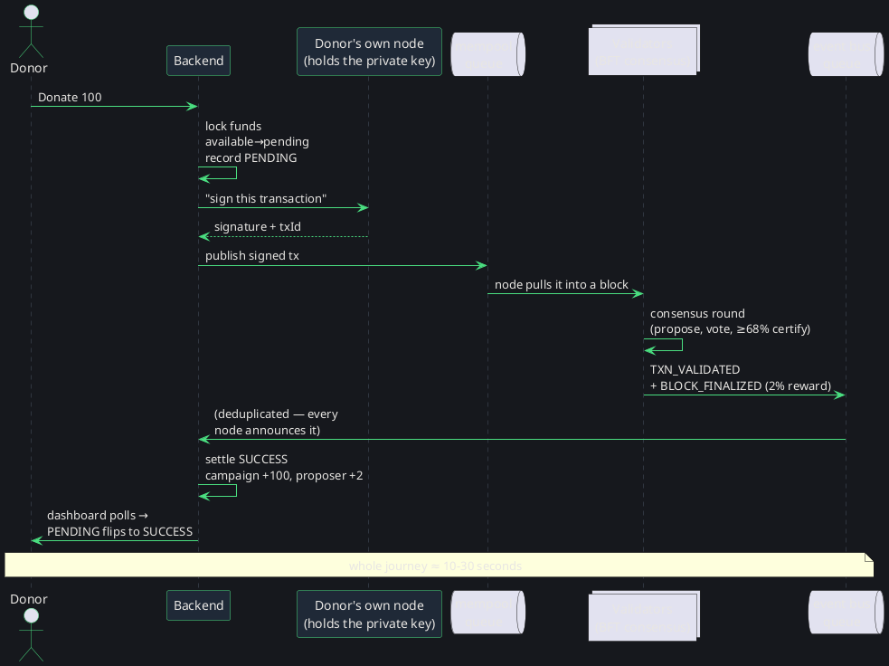
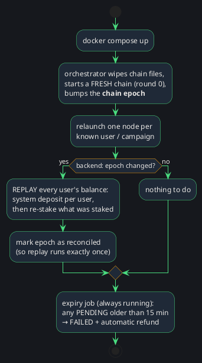

# PlantUML diagrams for the backend presentation

Render at https://www.plantuml.com/plantuml or with the VS Code PlantUML extension.
Dark-styled to blend into a dark slide deck. Companion to BACKEND_PRESENTATION.md.

## 1. Anchor architecture (show after "Backend Jobs", revisit every section)

## 2. Escrow state machine (one lifecycle for every money action)

## 3. Life of a donation (closing walkthrough / demo narration)

## 4. Restart resilience (chain ephemeral, database durable)

